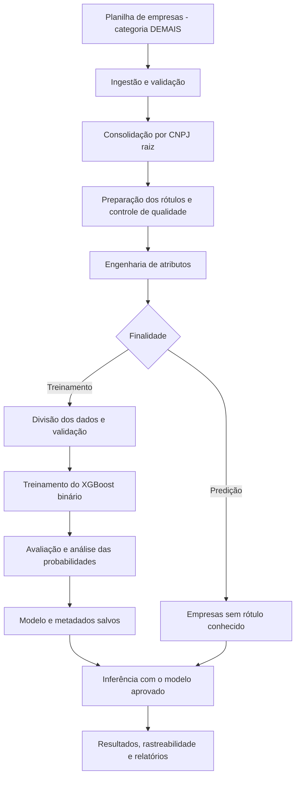

# Guia de desenvolvimento — Classificação do porte empresarial

> **Objetivo do documento:** orientar a implementação do projeto de mineração de dados, organizar as responsabilidades do código e acompanhar o que já foi definido, implementado e ainda está pendente. Atualize as caixas de seleção conforme o desenvolvimento avançar.
>
> **Escopo confirmado:** classificar empresas identificadas pelo **CNPJ raiz** em duas classes — **Médio** ou **Grande** — usando como exemplos de treinamento os registros que já possuem essas classificações na planilha disponível. As demais categorias (Micro e Pequena) não fazem parte do problema binário, pois já estão classificadas na base.

## 1. Arquitetura do projeto

A solução será um projeto Python modular, organizado por funcionalidade. A arquitetura deve ser simples: processamento local, arquivos Parquet para dados intermediários e um pipeline que coordena as etapas. Não há necessidade inicial de microsserviços, API, Spark, filas ou orquestradores.

### 1.1 Visão do fluxo



O fluxo deve manter **uma linha por CNPJ raiz** na base de modelagem. Os registros de estabelecimentos (CNPJ completo) são consolidados antes do treinamento e da predição. O CNPJ raiz é uma chave de relacionamento e agregação, não um atributo preditivo.

### 1.2 Estrutura de diretórios

```text
classificacao-porte/
│
├── data/
│   ├── raw/                    # Arquivos originais, preservados sem alteração
│   ├── interim/                # Dados após leitura, validações e consolidação
│   └── processed/              # Bases prontas para treinamento e inferência
│
├── notebooks/
│   └── analise_exploratoria.ipynb
│
├── src/
│   ├── config.py               # Caminhos, nomes de colunas e parâmetros gerais
│   ├── data/
│   │   ├── load_data.py        # Leitura das fontes
│   │   └── validate_data.py    # Validação estrutural e qualidade
│   ├── entities/
│   │   └── aggregate_root.py   # Consolidação dos estabelecimentos por CNPJ raiz
│   ├── labeling/
│   │   └── prepare_labels.py   # Construção e validação da variável-alvo
│   ├── preprocessing/
│   │   └── build_features.py  # Limpeza e engenharia de atributos
│   ├── model/
│   │   ├── train.py            # Treinamento do XGBoost
│   │   ├── evaluate.py         # Validação e métricas
│   │   └── predict.py          # Predição das empresas sem rótulo
│   ├── reporting/
│   │   └── export_results.py  # Exportação de previsões e relatórios
│   └── pipeline.py             # Coordenação das etapas
│
├── models/                     # Modelo aprovado e metadados da execução
├── outputs/
│   ├── predictions/            # Resultados por CNPJ raiz
│   └── reports/                # Métricas, gráficos e relatórios
│
├── tests/                      # Testes automatizados dos módulos
├── requirements.txt
├── .gitignore
└── README.md
```

### 1.3 Responsabilidade de cada módulo

| Módulo | Responsabilidade | Entrada principal | Saída principal |
|---|---|---|---|
| `data/load_data.py` | Ler Excel/CSV e padronizar tipos básicos | Arquivos de `data/raw/` | DataFrames de origem |
| `data/validate_data.py` | Verificar colunas, tipos, nulos, duplicidades e inconsistências | Dados carregados | Dados validados + relatório de qualidade |
| `entities/aggregate_root.py` | Transformar registros de estabelecimentos em registros de empresa | Dados validados | Uma linha por CNPJ raiz |
| `labeling/prepare_labels.py` | Extrair os rótulos Médio/Grande e resolver conflitos | Base consolidada | Conjunto rotulado + conjunto sem rótulo |
| `preprocessing/build_features.py` | Criar e selecionar atributos de entrada | Base por CNPJ raiz | Matriz de atributos `X` |
| `model/train.py` | Treinar e salvar o classificador | `X` e variável-alvo `y` | Modelo treinado |
| `model/evaluate.py` | Validar o modelo e calcular métricas | Modelo + dados de validação | Métricas, matriz de confusão e gráficos |
| `model/predict.py` | Estimar Médio/Grande para empresas sem rótulo | Modelo + `X` sem rótulo | Probabilidades e classe estimada |
| `reporting/export_results.py` | Exportar resultados e metadados | Previsões + informações de origem | CSV/Parquet e relatórios |
| `pipeline.py` | Executar as etapas na ordem correta | Configuração do projeto | Execução reproduzível |

**Princípio de organização:** cada módulo deve concentrar uma responsabilidade. Evite criar arquivos para funções triviais ou colocar todo o processamento em um único notebook. Os notebooks servem para exploração; a lógica reutilizável deve ficar em `src/`.

## 2. Decisões e premissas do projeto

| Tema | Decisão atual |
|---|---|
| Unidade de classificação | Empresa, identificada pelo CNPJ raiz |
| Problema | Classificação supervisionada binária |
| Classes-alvo | `Médio` e `Grande` |
| Registros de treinamento | Registros da planilha que já possuem `Obs Porte Sa3` classificado como Médio ou Grande |
| Micro e Pequena | Permanecem fora do treinamento binário e não serão reclassificadas |
| Empresas sem rótulo Médio/Grande | Recebem estimativa do modelo, desde que pertençam ao escopo DEMAIS |
| Algoritmo inicial | XGBoost (`XGBClassifier`, objetivo `binary:logistic`) |
| Linguagem | Python |
| Execução | Local, por pipeline modular |
| Resultado | Classe estimada, probabilidades e informação de rastreabilidade |

### 2.1 Perfil preliminar do arquivo disponível

A inspeção inicial da planilha `query_result_2026-10-06T08_52_19.110898753-03_00.xlsx` indicou:

- Uma aba (`Resultado da consulta`), aproximadamente **180.628 linhas** e **46 colunas**.
- Aproximadamente **163.658 CNPJs raiz distintos**; há raízes com mais de um estabelecimento.
- A coluna `Obs Porte Sa3` possui 239 registros preenchidos na inspeção inicial. Entre eles, foram identificados **45 como Média** e **18 como Grande**. Os demais valores observados incluem Pequena, Micro e registros sem informação.
- Esses números são um perfil preliminar do arquivo em nível de estabelecimento. A quantidade efetiva de exemplos de treinamento só será conhecida depois da consolidação por CNPJ raiz e da resolução de eventuais rótulos conflitantes.

A base contém majoritariamente empresas classificadas oficialmente como `DEMAIS`. A anotação em `Obs Porte Sa3` será usada como fonte do rótulo para os exemplos Médio/Grande, conforme a decisão do projeto. O campo de rótulo nunca poderá ser utilizado como atributo de entrada do modelo.

## 3. Cuidados essenciais com os dados

### 3.1 Capital social não pode ser usado isoladamente

**Capital social será apenas um dos atributos**, nunca uma regra única ou suficiente para definir o porte. Há muitas empresas com valor `0`, e a empresa pode não ser obrigada a declarar esse dado. Portanto:

- Não interpretar automaticamente capital social igual a zero como evidência de empresa pequena ou de baixo porte.
- Não criar uma regra do tipo `capital_social == 0` implica Médio/Grande ou Pequena/Micro.
- Preservar o valor original para auditoria. O zero permanece distinto de ausência (`NaN`).
- Se a fonte confirmar depois que zero representa falta de declaração, tratar zero como valor não informado na variável numérica do modelo e criar uma flag, por exemplo `capital_social_nao_informado`. Isso não muda a regra de julgamento abaixo.
- Separar valores ausentes (`NaN`) de zeros observados. A regra adotada não converte zero em ausência.
- Se houver transformação logarítmica, aplicá-la somente depois do tratamento de zero/ausência, por exemplo `log1p` sobre valores válidos.
- Fazer imputação, quando necessária, dentro do pipeline de treinamento do scikit-learn, para evitar vazamento entre treino e validação.
- Comparar o desempenho com e sem capital social; sua contribuição deve ser avaliada empiricamente.

O modelo deverá combinar diferentes dimensões da empresa. A ausência de capital social não pode impedir a classificação quando os outros atributos estiverem disponíveis.

**Regra registrada (26/11/2026):** `config.CAPITAL_SOCIAL_ZERO_RULE = "zero_nao_define_porte"`. Um valor 0 em uma métrica — capital social é o caso medido na planilha — não é evidência de pequeno porte e não classifica a empresa sozinho. A estimativa de Médio ou Grande considera o conjunto das métricas disponíveis.

### 3.2 Consolidação pelo CNPJ raiz

A planilha contém registros por estabelecimento. Antes de treinar ou prever, consolidar os registros para que cada CNPJ raiz apareça uma única vez.

Regras iniciais a implementar e validar:

- **Identificador:** manter CNPJ raiz como chave de agrupamento e saída, não como feature.
- **Quantidade de estabelecimentos:** criar atributo com a contagem de CNPJs completos associados à raiz.
- **Capital social:** não somar automaticamente. Verificar se o valor é repetido entre estabelecimentos; priorizar o valor consistente ou o registro da matriz conforme a semântica da fonte. Divergências devem ser sinalizadas.
- **Natureza jurídica:** verificar consistência entre estabelecimentos da mesma raiz; registrar divergências.
- **CNAE:** avaliar o CNAE principal da matriz como representante inicial. Como filiais podem ter atividades diferentes, considerar também quantidade de CNAEs distintos ou distribuição por divisão econômica, se isso agregar valor.
- **Situação cadastral:** não escolher arbitrariamente uma filial. Considerar a situação da matriz e/ou atributos agregados, como quantidade de estabelecimentos ativos e baixados.
- **Data de início:** definir, após inspeção, se a data da matriz representa a idade da empresa. Caso contrário, documentar uma agregação coerente, como a menor data de início válida.
- **Funcionários:** a coluna de observação de quantidade de funcionários apresenta muitas ausências. Só utilizá-la se houver cobertura e confiabilidade suficientes; ausência não equivale a zero funcionário.

Se houver mais de um rótulo válido para a mesma raiz (`Médio` em um registro e `Grande` em outro), não escolher um por maioria automaticamente. Registrar o conflito e excluir essa raiz do treinamento até que exista um critério fundamentado para resolvê-lo.

**Regras adotadas (26/11/2026), depois da inspeção da planilha real:**

- Capital social e natureza jurídica não variam dentro da raiz nesta base. O valor único é mantido, inclusive capital zero. Se aparecer divergência, usa-se o valor da matriz e a raiz fica marcada; sem matriz, o campo fica ausente.
- CNAE principal é o da matriz. Sem matriz (8.227 raízes), usa-se o estabelecimento de início mais antigo. Também se guardam a quantidade de CNAEs e de divisões.
- A situação usada como atributo da empresa é a da matriz, junto com as contagens por situação. Filial não ocupa o lugar de uma matriz ausente.
- A idade da empresa é a menor data de início válida. A data da matriz fica preservada; em 30 raízes uma filial é mais antiga.
- Funcionários só são copiados quando o valor é único. Ausência continua nula. Na base consolidada, 139 raízes têm o dado e as 63 de treino estão todas preenchidas; a Etapa 4 decide o uso no modelo.
- Na planilha real não houve raiz com Médio e Grande ao mesmo tempo. O código mesmo assim separa esse caso em `revisao`, sem rótulo.

### 3.3 Construção do rótulo binário

A coluna de origem do rótulo é `Obs Porte Sa3`. Padronizar grafias e espaços, depois mapear:

| Valor de origem | Rótulo de treinamento |
|---|---|
| `Média` / `Médio` (variações equivalentes) | `0` — Médio |
| `Grande` | `1` — Grande |
| `Pequena`, `Micro`, vazio ou sem informação | Não entra no treinamento binário |
| Valor desconhecido ou conflitante na mesma raiz | Revisar; não rotular automaticamente |

A convenção numérica `Médio = 0` e `Grande = 1` deve ser centralizada em configuração ou em uma função de mapeamento, e documentada no modelo salvo.

### 3.4 Atributos candidatos

Começar com um conjunto pequeno e justificável; ampliar somente quando a análise mostrar benefício.

| Atributo candidato | Origem / construção | Cuidados |
|---|---|---|
| Capital social | Campo cadastral | Não usar sozinho; tratar zeros e ausências com cuidado |
| Natureza jurídica | Campo cadastral | Categórico; conferir consistência na raiz |
| CNAE principal | Preferencialmente matriz | Categórico; evitar cardinalidade excessiva sem estratégia |
| Matriz/filial | Campo cadastral | Usar para agregações, não como identificador isolado |
| Quantidade de estabelecimentos | Contagem por CNPJ raiz | Feature agregada relevante |
| Situação cadastral | Matriz e/ou contagens agregadas | Definir regra de consolidação |
| Tempo de atividade | Data de início até uma data de referência | Evitar usar a data atual sem registrar a referência da execução |
| Quantidade de funcionários | Campo de observação, se confiável | Ausência não significa zero; medir cobertura |

Excluir das features identificadores diretos, como CNPJ, CNPJ raiz, razão social, e-mail e telefone. Também excluir a própria coluna `Obs Porte Sa3`, qualquer porte oficial/observado que revele a resposta e campos constantes ou sem significado preditivo no conjunto utilizado.

## 4. Etapas de desenvolvimento e acompanhamento

Legenda: `[x]` concluído/definido; `[ ]` pendente. Marque como concluído somente após implementar e validar a entrega correspondente.

### Etapa 0 — Definição do escopo

- [x] Definir o objetivo como estimativa de porte para empresas da categoria DEMAIS.
- [x] Definir CNPJ raiz como unidade de classificação.
- [x] Definir classificação binária: Médio ou Grande.
- [x] Definir uso dos registros já classificados na planilha como exemplos de treinamento.
- [x] Definir que Micro e Pequena não fazem parte do modelo binário.
- [x] Definir que capital social não será utilizado isoladamente.
- [ ] Registrar no README do repositório os responsáveis e a divisão de tarefas da equipe. ⚠ **Parcial:** os integrantes já estão no README; falta definir a divisão de tarefas.

### Etapa 1 — Preparação do ambiente e estrutura

- [x] Criar o repositório Git e a estrutura de diretórios apresentada na seção 1.2. _(remoto: `https://github.com/MiltonKiefer/classificacao-empresas`, branch `dev`)_
- [ ] Criar e ativar ambiente virtual Python. ⚠ **Pendente por pessoa:** cada integrante cria o seu `.venv` localmente (comandos no README); o ambiente não é versionado.
- [x] Criar `requirements.txt` com dependências e versões utilizadas. _(validado com Python 3.12)_
- [x] Criar `config.py` com caminhos, nomes das colunas, classes e semente aleatória. _(aliases de CNAE e telefone conferidos na planilha real em 26/11/2026)_
- [x] Configurar `.gitignore` para não versionar bases brutas, arquivos grandes, ambientes virtuais, caches e modelos gerados.
- [x] Criar testes básicos para configuração e leitura de arquivos. _(`tests/test_config.py`, `tests/test_load_data.py`)_

### Etapa 2 — Ingestão e análise exploratória

- [x] Localizar e inspecionar inicialmente a planilha de referência.
- [x] Identificar a aba, o volume aproximado de linhas/colunas e campos relevantes.
- [x] Implementar leitura reproduzível da planilha em `load_data.py`. _(executado na planilha real em 26/11/2026: 180.628 linhas)_
- [x] Preservar CNPJ, CNPJ raiz, CNAE e CEP como strings, sem perder zeros à esquerda. _(natureza jurídica também; conferido na planilha real)_
- [x] Implementar validações de esquema, tipos, chaves, duplicidades e valores ausentes. _(`validate_data.py`; relatório da planilha real sem erros de esquema)_
- [x] Gerar relatório de qualidade: nulos, zeros, distribuição de categorias, datas inválidas e valores extremos. _(`outputs/reports/relatorio_qualidade.md/.json`, gerado em 26/11/2026 sobre a planilha real)_
- [x] Medir especificamente a cobertura de capital social e de quantidade de funcionários. _(capital: 81,32% zeros e 0 nulos; funcionários: 0,08% no total e 100% nas classes Médio e Grande)_
- [x] Confirmar a semântica dos zeros de capital social e registrar a regra adotada. _(`config.CAPITAL_SOCIAL_ZERO_RULE = "zero_nao_define_porte"`: zero não é evidência de pequeno porte; a estimativa usa o conjunto das métricas; o valor 0 é preservado)_
- [x] Salvar os dados intermediários em Parquet. _(`data/interim/estabelecimentos.parquet` regenerado com a planilha real)_
- [x] Copiar a planilha para `data/raw/`, executar `python -m src.pipeline --etapa 2`, revisar o relatório e ajustar `COLUMN_ALIASES`. _(alias `codigo cnae fiscal principal` e `telefone1`; `cnae_principal` reconhecido: 1.076 valores, 0 nulos)_

**Entrega da etapa:** relatório exploratório reproduzível e arquivos intermediários validados.

> **Status (26/11/2026):** Etapa 2 fechada na planilha real (180.628 linhas, 25 testes). O relatório não aponta erro de esquema. Para a Etapa 4 permanece o aviso de cobertura de funcionários (0,08% no arquivo; 100% nas classes Médio e Grande já rotuladas).

### Etapa 3 — Consolidação por CNPJ raiz e preparação dos rótulos

- [x] Implementar agrupamento de estabelecimentos por CNPJ raiz. _(`src/entities/aggregate_root.py`; 180.628 estabelecimentos → 163.658 raízes)_
- [x] Definir e documentar a agregação de cada campo (matriz, filiais, capital social, CNAE, situação e datas). _(seção 3.2 e `outputs/reports/relatorio_rotulos.md`)_
- [x] Criar atributos agregados, começando pela quantidade de estabelecimentos.
- [x] Identificar raízes com informações contraditórias. _(capital 0, natureza 0, CNAE 2.708, filial mais antiga que a matriz 30, rótulos 0)_
- [x] Mapear `Obs Porte Sa3` para as classes Médio e Grande. _(`src/labeling/prepare_labels.py`; Médio = 0, Grande = 1)_
- [x] Detectar raízes com rótulos conflitantes e separá-las para revisão. _(nenhuma raiz com Médio e Grande ao mesmo tempo)_
- [x] Gerar contagem final de empresas rotuladas por classe após agregação. _(treino: 45 Médio e 18 Grande)_
- [x] Separar empresas com rótulo conhecido das empresas elegíveis à inferência. _(treino 63, inferência 163.521, fora do escopo 74 — Micro e Pequena —, revisão 0)_

**Entrega da etapa:** uma base por CNPJ raiz, com rótulos validados e conjuntos claramente separados.

> **Status (26/11/2026):** base em `data/processed/empresas_raiz.parquet`. A contagem por raiz não reduziu as classes: continuam 45 Médio e 18 Grande, sem conflito. Essa é a amostra da Etapa 5.

### Etapa 4 — Engenharia e preparação dos atributos

- [x] Implementar a seleção das features candidatas da seção 3.4. _(16 colunas; CNAE completo trocado pela divisão de 2 dígitos)_
- [x] Tratar capital social conforme a regra validada na seção 3.1. _(`log1p` preserva o zero e `capital_social_zero` entra junto com as outras colunas)_
- [x] Criar tempo de atividade e atributos agregados de estabelecimentos. _(idade até 2026-10-06; quantidades já consolidadas na Etapa 3)_
- [x] Tratar categorias e valores ausentes com `ColumnTransformer` e transformadores do scikit-learn. _(mediana, moda e one-hot com `min_frequency=2`)_
- [x] Garantir que imputadores, codificadores e demais transformações sejam ajustados somente nos dados de treino de cada partição. _(o transformador é criado sem `fit`; a Etapa 5 ajusta cada partição)_
- [x] Verificar e remover features que revelem direta ou indiretamente o rótulo. _(rótulo, porte oficial e funcionários ficaram de fora; funcionários só existem nas empresas já anotadas)_
- [x] Salvar a matriz de atributos e um dicionário de dados/feature list. _(`data/processed/features.parquet`, 63 treino e 163.521 inferência; `outputs/reports/dicionario_features.md`)_

**Entrega da etapa:** matriz `X` e vetor `y` documentados, reproduzíveis e sem vazamento de rótulo.

> **Status (26/11/2026):** ajuste só no treino produz 29 colunas codificadas. O transformador ajustado não é gravado nesta etapa.

### Etapa 5 — Treinamento e avaliação

- [x] Criar um baseline simples para comparação (por exemplo, classe majoritária e/ou modelo de árvore simples). _(maioria: F1-macro 0,417; árvore de profundidade 3: 0,449)_
- [x] Implementar `XGBClassifier` com objetivo binário (`binary:logistic`).
- [x] Avaliar distribuição das classes após consolidação; não assumir que os números em nível de estabelecimento são os números finais. _(45 Médio e 18 Grande, os mesmos depois da Etapa 3)_
- [x] Escolher estratégia de validação compatível com o tamanho real da amostra. _(StratifiedKFold com 3 folds e semente 42; cada teste fica com 6 Grande)_
- [x] Comparar modelo sem pesos e com pesos de classe, se o desbalanceamento justificar. _(sem peso: F1-macro 0,508 e recall Grande 0,222; com peso: 0,524 e 0,389)_
- [x] Ajustar hiperparâmetros somente dentro dos dados de treinamento/validação. _(profundidade 2 ou 3 escolhida numa validação interna de cada fold)_
- [x] Calcular F1-macro, acurácia balanceada, precisão/recall por classe e matriz de confusão. _(`outputs/reports/relatorio_avaliacao.md`)_
- [x] Analisar especialmente o recall de `Grande`, sem ignorar o desempenho em `Médio`. _(Grande 0,389, variando 0,33–0,50 entre folds; Médio 0,667 no modelo com peso)_
- [x] Avaliar a calibração das probabilidades; só aplicar calibrador se houver amostra suficiente para uma avaliação minimamente estável. _(calibrador não aplicado; o Brier fica só registrado)_
- [x] Salvar modelo, configuração, lista de features, métricas e versão dos dados. _(`models/porte_xgb.joblib`, variante `xgb_ponderado`, profundidade 2, reajustado nas 63 empresas)_

**Atenção ao tamanho da amostra:** a validação confirmou 45 Médio e 18 Grande por CNPJ raiz. A validação estratificada de 3 folds deixa 6 Grande em cada teste. As métricas são exploratórias e não são evidência forte de generalização.

Não foi aplicado oversampling. O peso da classe Grande, quando usado, é contado só dentro do treino de cada fold.

**Entrega da etapa:** modelo avaliado, métricas registradas e limitações explicitadas.

> **Status (26/11/2026):** o modelo gravado é o XGBoost com peso. Na validação cruzada, F1-macro 0,524, recall Grande 0,389 e recall Médio 0,667. A matriz de confusão acertou 7 das 18 Grande e 30 das 45 Médio.

### Etapa 6 — Inferência das empresas sem rótulo

- [ ] Carregar o modelo aprovado e a mesma lógica de preparação de features utilizada no treinamento. _(implementado; teste automatizado ainda não executado)_
- [ ] Selecionar empresas DEMAIS sem rótulo Médio/Grande conhecido. _(somente conjunto `inferencia`; implementação pendente de validação)_
- [ ] Gerar probabilidades para Médio e Grande e a classe prevista. _(implementado; teste automatizado ainda não executado)_
- [ ] Não sobrescrever classificações oficiais nem os rótulos conhecidos usados no treinamento. _(saída separada; apenas as empresas de inferência são previstas)_
- [ ] Sinalizar para revisão manual. _(todas as estimativas são sinalizadas: as probabilidades não foram calibradas e a avaliação não persistiu probabilidades fora do fold; nenhum limiar arbitrário é aplicado)_
- [ ] Registrar modelo, versão dos dados e data da execução para cada lote de resultados. _(hash SHA-256 do modelo, da base consolidada e das features; variante e timestamp por linha)_

**Entrega da etapa:** `outputs/predictions/predicoes.parquet`, com previsões por CNPJ raiz e sem alterar a informação original.

> **Status (26/11/2026):** implementação concluída; a validação automatizada ainda depende de um ambiente Python disponível.

### Etapa 7 — Exportação, testes e documentação

- [ ] Exportar previsões em CSV e Parquet. _(implementado; validação automatizada pendente)_
- [ ] Incluir CNPJ raiz, porte original, porte estimado, probabilidades por classe, status da classificação, versão do modelo e data da execução. _(implementado; validação automatizada pendente)_
- [ ] Diferenciar explicitamente `rótulo conhecido` de `estimativa do modelo`. _(campos `rotulo_conhecido` e `porte_estimado`, com status distintos)_
- [ ] Criar relatório de distribuição das classes estimadas e casos sinalizados para revisão. _(Markdown e JSON)_
- [ ] Criar testes unitários para agregação por raiz, mapeamento de rótulos, tratamento de capital social e geração de features. _(testes existentes nas etapas anteriores e novos testes da exportação)_
- [ ] Criar teste de integração para executar o pipeline com uma amostra pequena. _(teste de exportação CSV/Parquet com dados sintéticos; execução pendente)_
- [ ] Documentar como instalar dependências e executar cada etapa no README. _(inclui instalação do Python no Windows e comandos das etapas 2–7)_

**Entrega final:** pipeline executável, resultados rastreáveis, testes básicos e documentação de uso. A Etapa 7 produz
`outputs/predictions/resultado_classificacao.csv/.parquet` e `outputs/reports/relatorio_resultados.md/.json`.

> **Status (26/11/2026):** implementação das Etapas 6 e 7 concluída; a validação automatizada aguarda a instalação e configuração do Python no notebook.

## 5. Estratégia de validação e limitações

1. **Uma empresa, uma observação:** consolidar por CNPJ raiz antes de separar treino e validação. Assim, estabelecimentos da mesma empresa não aparecem em partições diferentes.
2. **Amostra reduzida:** depois da consolidação por raiz, o treino ficou com 63 empresas e rótulos consistentes: 45 Médio e 18 Grande. Nenhuma raiz teve Médio e Grande ao mesmo tempo. A avaliação da Etapa 5 deve usar essa contagem, não a contagem por estabelecimento.
3. **Desbalanceamento:** acompanhar a proporção Médio/Grande e apresentar métricas por classe, não somente acurácia.
4. **Probabilidade não é garantia:** a probabilidade prevista pelo XGBoost não deve ser chamada automaticamente de confiança confiável. Calibração e limiares de revisão precisam ser avaliados; com poucos exemplos, a incerteza deve ser declarada.
5. **Escopo das conclusões:** enquanto a base rotulada for pequena, as previsões devem ser tratadas como estimativas exploratórias, não como classificação oficial ou validação definitiva do porte empresarial.
6. **Reprodutibilidade:** registrar semente aleatória, versão dos dados, parâmetros, features e métricas em cada treinamento.
7. **Revisão das estimativas:** enquanto as probabilidades não forem calibradas e não houver probabilidades fora do fold persistidas para validar um limiar, todas as estimativas da Etapa 6 ficam recomendadas para revisão manual.

## 6. Tecnologias e dependências

| Tecnologia | Uso |
|---|---|
| Python | Linguagem principal |
| pandas | Leitura, limpeza e transformação tabular |
| openpyxl | Leitura de arquivos Excel pelo pandas |
| PyArrow | Leitura/escrita de Parquet |
| scikit-learn | Pipelines, pré-processamento, validação e métricas |
| XGBoost | Classificador binário |
| joblib | Persistência do pipeline/modelo |
| matplotlib | Gráficos e relatórios |
| pytest | Testes automatizados |

O conjunto exato de versões deve ser registrado em `requirements.txt` depois que o ambiente inicial for validado. Começar com essas bibliotecas é suficiente; adicionar ferramentas só quando existir uma necessidade concreta.

## 7. Contrato esperado dos resultados

Cada registro de saída deve representar uma empresa (CNPJ raiz), com campos equivalentes aos seguintes:

| Campo | Descrição |
|---|---|
| `cnpj_raiz` | Identificador da empresa |
| `porte_original` | Classificação original disponível na base |
| `porte_estimado` | `Médio` ou `Grande`, quando houver predição |
| `prob_medio` | Probabilidade estimada para a classe Médio |
| `prob_grande` | Probabilidade estimada para a classe Grande |
| `status_classificacao` | `rotulo_conhecido` ou `estimativa_modelo` |
| `modelo_versao` | Identificação da versão do modelo |
| `modelo_variante` | Variante escolhida na Etapa 5 |
| `dados_versao` | Fingerprint dos Parquets de features e empresas consolidadas |
| `data_execucao` | Data/hora da execução |
| `revisao_recomendada` | Indicador conservador; na Etapa 6 atual, todas as estimativas são sinalizadas |

Os nomes finais podem ser ajustados ao padrão do código. O essencial é preservar a distinção entre dado de origem e estimativa. Não substituir o porte oficial `DEMAIS` por Médio/Grande no campo original; armazenar a previsão em colunas separadas.

## 8. Critérios mínimos para considerar o projeto concluído

- [ ] A leitura e a preparação da base podem ser repetidas sem intervenção manual em cada execução.
- [ ] Há uma linha por CNPJ raiz no conjunto de modelagem.
- [ ] Os rótulos de treinamento são apenas Médio/Grande e conflitos são tratados explicitamente.
- [ ] Capital social não é usado como regra única; zeros e ausências são tratados conforme a semântica confirmada.
- [ ] O pipeline de transformação é o mesmo no treinamento e na inferência.
- [ ] O modelo foi avaliado com métricas por classe e limitações da amostra foram registradas.
- [ ] As empresas sem rótulo recebem estimativas sem sobrescrever dados originais.
- [ ] Cada previsão pode ser rastreada até a versão do modelo e a execução que a produziu.
- [ ] Existem instruções de instalação e execução no README e testes básicos para os componentes críticos.

---

**Documento de referência:** artigo parcial *Classificação de Porte Empresarial — Mineração de Dados* e planilha `query_result_2026-10-06T08_52_19.110898753-03_00.xlsx`. Este guia registra o escopo definido até 23/11/2026; decisões técnicas ainda não testadas estão marcadas como pendentes e devem ser confirmadas durante a implementação.
